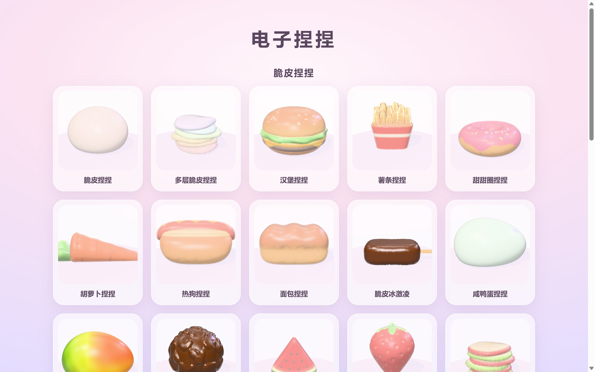
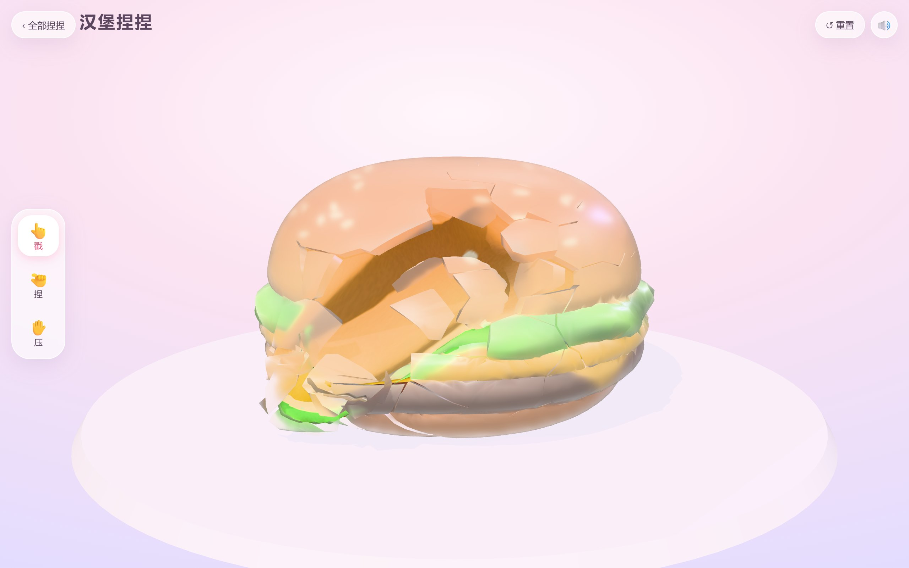
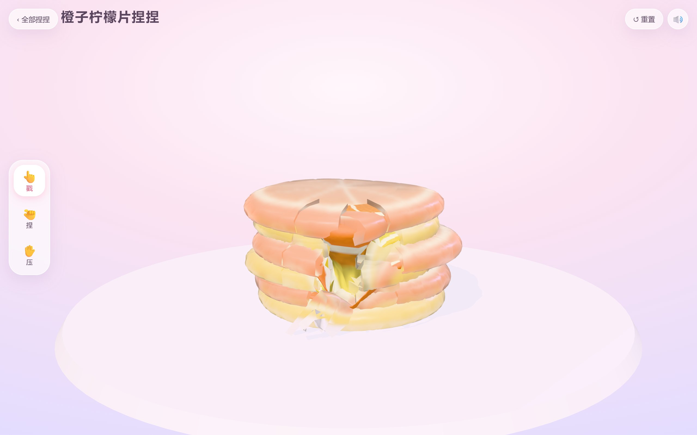

# 电子捏捏 · online-squishy-model

在浏览器里捏的解压玩具：29 只捏捏，能戳、能捏、能压，蜡壳会裂会碎，史莱姆会流，汽水会冒泡。

**在线试玩：<https://yangtianxu920-arch.github.io/online-squishy-model/>**（电脑和手机浏览器都可以，第一次点一下页面才有声音）



| 压碎的汉堡 | 橙子柠檬片 |
|---|---|
|  |  |

## 里面有什么

| 分类 | 捏捏 |
|---|---|
| 脆皮捏捏 | 脆皮、多层脆皮、汉堡、薯条、甜甜圈、胡萝卜、热狗、面包、脆皮冰激凌、咸鸭蛋、芒果爆浆、巧克力脆球、西瓜、草莓、苹果片、橙子柠檬片 |
| 球皮捏捏 | 麦芽糖、粉珠、蓝珠、积木、凡士林黄油条 |
| 气泡捏捏 | 碳酸小袋子、橘子、可乐、荔枝气泡水 |
| 其他 | 肥皂球、草莓蛋糕、奶油小猫、史莱姆 |

三种手势：**戳**（一根手指按进去）、**捏**（两根手指夹住）、**压**（整个手掌压下去）。拖动空白处可以转视角。

## 是怎么做的

整个游戏是一个 `index.html`，没有后端，没有构建步骤，渲染用 [three.js](https://threejs.org/)。

- **软体**：每只捏捏是一个细分球面变形出来的网格，用形状匹配 + 体积守恒来模拟。不同材质（Q 弹硅胶、黏土、麦芽糖、灌了水的袋子）只是弹性、阻尼、塑性这几个参数不同。
- **会碎的蜡壳**：壳在球面上预先分成两百多块碎片，每块跟着底下的黏土走；黏土变形超过阈值，碎片先裂开、再整块掉下来。半透明的磨砂效果用的是 three.js 的透射材质。
- **流体**：史莱姆和爆浆的馅是粘弹性流体粒子（双密度松弛 + 可塑的弹簧键），表面用 marching cubes 重建。
- **黏土混色**：揉的时候颜色先被搅出大理石纹，再慢慢混成一色，在着色器里完成。
- **声音**：一部分是 WebAudio 实时合成的，一部分是用 ElevenLabs 生成的音效录音，播放时随机切片、变调，所以听不出重复。
- **微信小游戏版**：`wxapp/` 里是移植工程。游戏代码不另外维护，打包时直接从 `index.html` 里取出来，再用一层适配代码把浏览器接口换成微信的接口。

代码里的中文注释写得比较细，想知道某个效果怎么实现的可以直接搜。

## 在自己电脑上运行

下载或克隆这个仓库，双击 `index.html` 就能玩（需要联网，three.js 从 CDN 加载）。

```
index.html            游戏本体
sounds.js             音效（由 sounds/build_sounds.py 从 sounds/*.mp3 生成）
build-release.mjs     生成去注释、压缩过的离线版本（输出到「试玩版」文件夹）
wxapp/                微信小游戏工程
  build/              打包脚本和适配层（shim.js、ui.js、main.js）
  minigame/           小游戏目录（game.js 等由打包脚本生成）
```

想重新生成离线版或小游戏包，需要 Node.js：

```
cd wxapp/build && npm install
node build.mjs                  # 生成微信小游戏的 game.js
cd ../.. && node build-release.mjs   # 生成离线版
```

微信小游戏需要自己的 AppID：把 `wxapp/project.config.example.json` 复制成 `project.config.json`，填上 AppID，再用微信开发者工具打开 `wxapp` 文件夹。

## 说明

- 玩法设计、每只捏捏的手感和声音都是一轮轮试出来的；开发过程使用了 AI 辅助编程（Claude）。
- 代码以 [MIT 许可证](LICENSE) 开源。three.js 为 MIT 许可。
